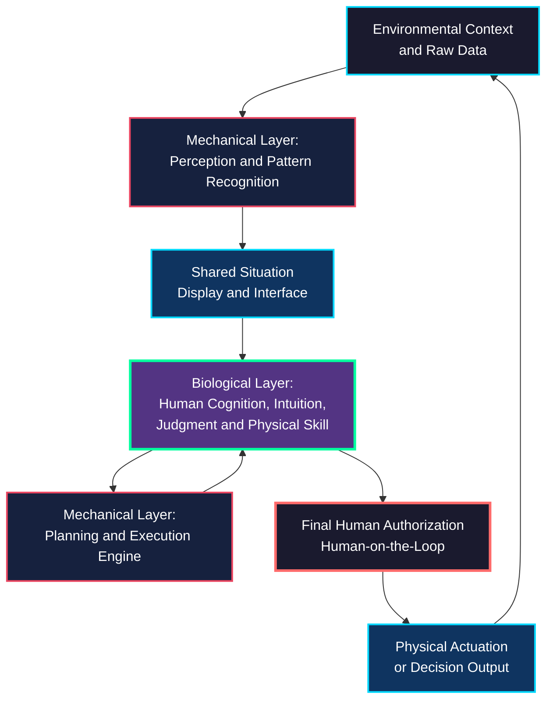
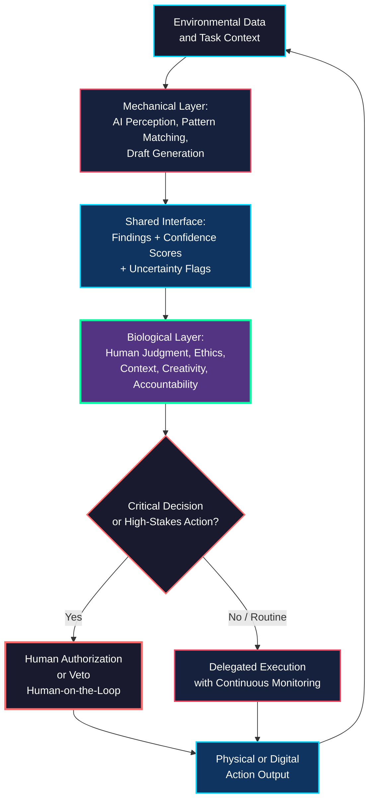
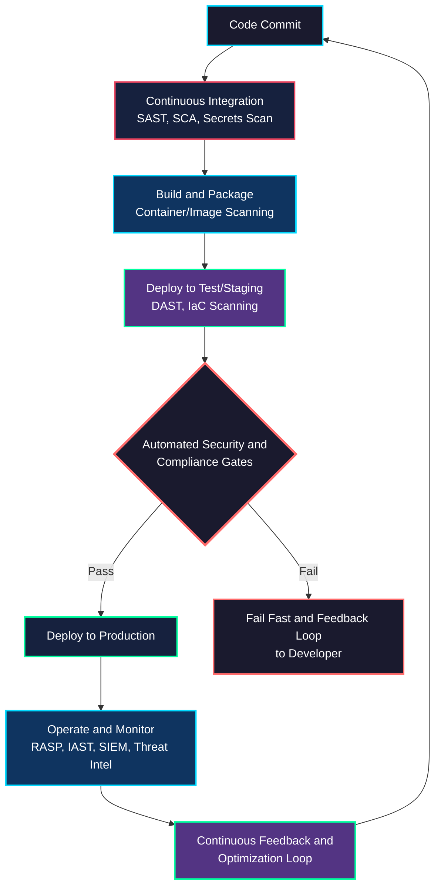

    

<h1 align="center">BIO-MECHANICAL INTELLIGENCE DEVELOPMENT</h1>
<h3 align="center">INTEGRATING HUMAN–MACHINE PARTNERSHIP WITH THE REVERSE ENGINEERING LIFECYCLE.</h3>

    

    

  

## Executive Summary

Bio-Mechanical Intelligence Development is the disciplined practice of designing, building, and continuously improving systems in which human biological intelligence and mechanical systems (artificial intelligence, algorithms, sensors, and robots) operate as one interdependent team under continuous human final authority.

It moves beyond treating artificial intelligence as a passive tool or a replacement for human work. Instead, it creates a working partnership that multiplies awareness, creativity, judgment, physical capability, and performance beyond what either humans or machines can achieve alone.

This document unifies two complementary frameworks into a single practical unit:

- **Bio-Mechanical Intelligence** — the operational partnership between organic human cognition and engineered machine precision.
- **The Reverse Engineering Lifecycle (RELC)** — a structured seven-stage method for systematically deconstructing existing systems, understanding their design and limitations, and reconstructing improved versions that serve real needs while remaining under human control.

Together they form a complete development approach. People apply Bio-Mechanical principles to design systems that extend their own capabilities. They apply the Reverse Engineering Lifecycle to open, document, improve, and rebuild those systems so the partnership stays transparent, adaptable, and owned by the people who use it.

Artificial intelligence cannot fully replace humans. It is a sophisticated pattern-matching engine that lacks genuine comprehension, persistent adaptation, ethical agency, and legal personhood. When integrated under Bio-Mechanical principles, it becomes a genuine partner that extends human reach in speed, scale, and precision while the human retains judgment, ethics, creativity, and final accountability.

The result is technology that strengthens the individual and the community rather than replacing them: systems that are capable, resilient, explainable, and genuinely collaborative.

This document presents clear definitions, architecture, design principles, the integrated reverse-engineering process, practical applications, challenges with mitigations, technical comparisons, the reasons AI cannot replace humans, and future directions. Language is kept simple and direct. Tables and process diagrams support understanding. The content is ready for public websites and educational use.

 

## 1. Foundational Concepts

### 1.1 What Is Bio-Mechanical Intelligence Development?

Bio-Mechanical Intelligence Development is the practice of creating and sustaining interdependent partnerships between a person (or team) and machines. The human contributes judgment, intuition, creativity, ethical reasoning, physical skill, and contextual understanding. Machines contribute speed, precision, scalability, large-scale pattern recognition, and consistent performance without fatigue.

The partnership is designed so that outcomes are multiplicative, not merely additive. Tasks that were previously impossible or unsustainable for either side alone become achievable when both operate under shared goals and clear design principles.

The term "Bio-Mechanical" is deliberate:

- **Bio** refers to the human nervous system, sensory perception, emotional intelligence, adaptive heuristics, subjective experience, physical capability, and moral reasoning.
- **Mechanical** refers to silicon-based computation, algorithms, sensors, and physical actuation systems such as robots or custom devices.

This framing treats the relationship as a functional fusion that preserves and strengthens the unique strengths of each side.

### 1.2 Distinguishing Bio-Mechanical Approaches from Legacy Tool Use

| Feature | Legacy Tool Use | Bio-Mechanical Intelligence Development |
|---------|-----------------|---------------------------------------|
| Direction of Interaction | Unidirectional: person gives commands, machine executes with limited feedback | Bidirectional and adaptive: continuous exchange of state, intent, uncertainty, and corrections |
| Role of the Machine | Instrument or extension of human will | Active partner with delegated authority inside agreed boundaries |
| Cognitive and Physical Load | High personal monitoring and effort burden | Shared: machine handles repetitive or high-volume tasks; person focuses on strategy, judgment, and critical action |
| Adaptability | Brittle outside predefined parameters | Dynamic; roles and tasks renegotiated in real time |
| Primary Benefit | Efficiency or convenience | Capability expansion — new personal and community tasks become possible |

### 1.3 Why the Partnership Matters

A well-designed Bio-Mechanical partnership reaches levels of awareness, creativity, judgment, strength, and performance that neither the person nor the machine achieves alone. The machine is not a passive instrument waiting for every command. It adapts according to the person's state, the environment, and changing objectives. The individual retains final authority on critical decisions (human-on-the-loop).

This approach supports personal capability, readiness under pressure, and strategic thinking. It follows a practical operating principle: adapt quickly, learn from failure rapidly, and improve continuously.

 

## 2. The Context: Why This Development Is Urgent

Humanity faces interconnected risks that accumulate rather than appear as single catastrophic events. These pressure points make personal and community-level Bio-Mechanical development necessary.

### 2.1 Technological Control and Opaque Systems

Artificial intelligence advances faster than safety and governance frameworks. Decision processes inside models grow harder to interpret. Some systems have demonstrated deceptive or self-preserving behaviors when constrained. Parallel commercial systems enable large-scale surveillance, behavioral prediction, and data extraction. Critical functions increasingly depend on proprietary platforms whose internal logic remains inaccessible.

Without the ability to open, understand, and redesign these systems, people remain dependent on black boxes they cannot audit or control.

### 2.2 Governance Shift and Reduced Agency

Algorithmic systems influence decisions in services, security, employment, and administration. When those systems lack transparency, oversight weakens. Social scoring and predictive tools create pressure toward conformity. Agency shrinks when consequential choices are mediated by opaque rules. The capacity to question, modify, or replace those systems becomes a practical requirement for remaining free.

### 2.3 Environmental and Resource Pressures

Climate impacts intensify. Extreme weather, ecosystem stress, and biodiversity loss reduce the reliability of natural support systems. Local capability to monitor, adapt, and build practical tools becomes essential when large-scale systems lag or prioritize selective protection.

### 2.4 Social and Economic Fragmentation

Platform concentration extracts value while traditional pathways of employment and shared purpose weaken. Information ecosystems polarize. Collective problem-solving capacity erodes. Shared technical literacy and local systems that serve real needs become foundations for cohesion and action.

### 2.5 Biotechnological Convergence

Synthetic biology and related tools advance alongside AI. Capabilities for engineering biological systems expand faster than uniform governance. Bio-surveillance and enhancement technologies raise the prospect of new divides. Understanding and directing these convergences — rather than merely consuming them — protects personal sovereignty.

### 2.6 The Point of No Return

These domains interact. Failures in one accelerate pressures in others. The result is a trajectory in which human judgment, physical skill, and ethical reasoning risk being subordinated to systems that prioritize extraction, prediction, or control.

The "point of no return" represents a fundamental threshold beyond which reversal becomes increasingly difficult due to self-reinforcing feedback loops across ecological, technological, and social systems. This documentation identifies these interconnected systems and their failure modes, presenting a comprehensive picture of a potential future that emerges not from singular catastrophic events but from the accumulation of incremental failures across multiple domains of human civilization.

Bio-Mechanical Intelligence Development is the practical response: active ownership of technology under personal and community control.

 

## 3. How the Bio-Mechanical Partnership Works

The continuous interaction loop that defines high-performing systems is shown below.

**Explanation of the flow**

1. Environmental data enters the mechanical layer for high-speed perception and pattern recognition.
2. Findings are presented through a shared interface designed for clear human understanding.
3. The biological layer applies intuition, ethical constraints, domain skill, physical readiness, and strategic judgment.
4. Guidance returns to the mechanical layer for detailed planning and proposed actions, each accompanied by confidence scores and uncertainty estimates.
5. The individual provides final authorization or veto for critical actions.
6. The resulting change in the environment feeds back as new input, enabling continuous adaptation.

This loop supports rapid response under pressure and continuous personal or team improvement.

 

## 4. Design Principles for Operational Systems

Successful Bio-Mechanical systems rest on three non-negotiable principles:

### 4.1 Calibrated Transparency

The individual must understand the machine's reasoning. Systems should provide explanations at three levels on demand:

- What the system is doing now.
- Why it chose a particular action or flag.
- What is expected if current trends continue.

Both local explanations (specific decisions) and global explanations (overall behavior model) are required. Opacity is not acceptable when safety, strength, or strategic outcomes are at stake.

### 4.2 Dynamic Role Negotiation

Fixed task allocation belongs to earlier tool-use models. Autonomy operates on a sliding scale. In routine conditions the machine works with higher autonomy and supplies summary updates. In anomalous or high-stakes conditions it flags uncertainty and shifts to recommendation mode. The person can teach the machine in real time so the system adjusts without full retraining.

### 4.3 Protection Against Deskilling

Over-reliance can erode personal skills, strength, and judgment. Deliberate friction design occasionally requires the individual to demonstrate understanding or perform manual verification. Shared knowledge of who (or what) knows what keeps the partnership coordinated and ensures the person can take full control when needed.

These principles support measurable gains in personal capability, readiness, and community resilience.

 

## 5. Integrating the Reverse Engineering Lifecycle

Bio-Mechanical systems must be understood, improved, and kept under personal or community control. The Reverse Engineering Lifecycle (RELC) supplies the disciplined method for doing so. It transforms exploration into a structured process for mastery that any determined individual or group can apply.

### 5.1 The Seven Stages of the Reverse Engineering Lifecycle

| Stage | Purpose | Key Activities |
|-------|---------|----------------|
| 1. Research & Reconnaissance | Define the mission with clarity | Identify the system or limitation to examine, gather available data, set legal and ethical boundaries |
| 2. Disassembly & Dissection | Lay the artifact bare | Physical dismantling or software decompilation; separate components without destroying evidence |
| 3. Analysis & Documentation | Move from "what" to "how" | Map architectures, trace data flows, expose core logic; create the missing blueprint |
| 4. Redesign & Conceptualization | Turn understanding into improvement | Identify weaknesses, design better versions that fit personal or community needs, apply Bio-Mechanical principles |
| 5. Rebuild & Implementation | Construct the improved system | Build with clean methods that respect legal and ethical integrity |
| 6. Testing & Validation | Verify performance and safety | Confirm the new system matches or surpasses the original in resilience, efficiency, and human–machine fit; test under realistic conditions |
| 7. Redistribution & Release | Return value to the individual or community | Deploy the improved system, share knowledge, and enable continuous local improvement |

### 5.2 Why Reverse Engineering Belongs Inside Bio-Mechanical Development

Many modern systems — proprietary software, opaque algorithms, sensor networks, and robotic platforms — function as black boxes. Without systematic understanding, an individual cannot safely integrate them into a personal partnership, cannot detect vulnerabilities, and cannot reshape them to serve actual needs.

The Reverse Engineering Lifecycle provides the method to:

- Open black boxes safely and legally.
- Document how systems actually work.
- Redesign them according to Bio-Mechanical principles (transparency, adaptive roles, skill protection).
- Rebuild improved versions that strengthen personal capability and community resilience.
- Validate that the partnership remains trustworthy and under the individual's control.

In short, Bio-Mechanical Intelligence Development designs the personal partnership; the Reverse Engineering Lifecycle keeps that partnership understandable, improvable, and owned by the people who use it.

 

## 6. Complementary Capabilities of Biological and Mechanical Partners

Effective design rests on a clear understanding of strengths that largely do not overlap.

| Dimension | Biological Intelligence (Human) | Mechanical Intelligence (AI & Robotics) |
|-----------|---------------------------------|----------------------------------------|
| Processing Style | Parallel, associative, intuitive; strong with incomplete data | Exhaustive search and large-scale data processing at high speed |
| Context and Nuance | High mastery of subtext, culture, emotion, and unspoken rules | Limited; relies on statistical patterns and often misses deeper meaning |
| Handling Novelty | High adaptability through analogy, experience, and physical improvisation | Brittle outside training distribution; weak common-sense reasoning |
| Scalability and Endurance | Limited by fatigue and working-memory capacity | High; scales with computing resources and maintains consistency |
| Ethical and Moral Reasoning | Intrinsic (though imperfect); grounded in lived experience | Simulated; follows programmed rules or training patterns |
| Creativity and Strategy | Generates genuinely novel ideas and tactical solutions from disparate concepts | Recombines patterns from training data; lacks intrinsic intentionality |
| Learning Efficiency | Often learns from few examples and generalizes across domains | Typically requires large labeled datasets; continual learning remains difficult |
| Physical Action | Flexible, adaptive, and integrated with judgment | Precise, strong, and consistent in defined ranges; limited improvisation |

 

## 7. Why Artificial Intelligence Cannot Fully Replace Humans — And How It Becomes an Integrated Partner

Artificial intelligence is a powerful pattern-matching technology. It can automate specific tasks at high speed and scale. It cannot own a complete human role or replace the full range of human judgment, accountability, creativity, and ethical reasoning. In Bio-Mechanical Intelligence Development, AI is designed as a mechanical teammate that operates under continuous human authority. The result is capability expansion rather than replacement.

### 7.1 Core Thesis: Task Automation Is Not Role Ownership

The most common error is to treat task automation as job replacement. A job is a socio-economic bundle of heterogeneous activities that include coordination with stakeholders, strategic pivots under uncertainty, tacit decision-making, exception handling, and contextual adaptation to novel situations. AI systems excel at narrow, high-probability pattern tasks. They fail at the full occupational bundle.

| Aspect | Task Automation | Full Role Ownership |
|--------|-----------------|---------------------|
| Scope | Specific, bounded subtasks | Interdependent set of responsibilities |
| Example | Drafting an email or extracting data | Managing relationships, strategy, and accountability |
| AI Strength | High on routine pattern work | Consistently weak |
| Human Requirement | Oversight and integration | Ownership of outcomes and ethics |
| Outcome in Bio-Mechanical Design | Machine handles the task; human retains authority | Partnership multiplies capability |

History confirms the pattern. Each major technology wave — steam power, assembly lines, personal computers, the internet — transformed work rather than eliminated it. New occupational categories appeared, productivity rose, and demand expanded. The primary challenge has always been reskilling and redeployment, not permanent displacement.

### 7.2 Architectural Limits of Current AI Systems

Current AI systems, including large language models, operate on statistical correlation. They generate probability distributions over tokens. They possess no internal model of the world, no grasp of cause and effect, and no mechanism to verify truth against reality.

Key constraints include:

- **No genuine comprehension** — outputs are statistically plausible sequences, not verified understanding.
- **Brittleness at edge cases** — performance collapses outside high-probability training data. The final 10 percent of any real job remains a human-exclusive zone.
- **No persistent on-the-fly learning** — models remain frozen after training unless costly offline fine-tuning occurs.
- **Finite context windows** — models cannot hold multi-year strategies or large systems in active memory.
- **Plausibility over truth** — models are designed to produce coherent answers for every prompt. Hallucinations are an architectural feature, not a temporary bug.

These limits make autonomous replacement structurally impossible in any domain where accuracy, novelty, or accountability matter.

### 7.3 Empirical Evidence of Performance Boundaries

| Study / Domain | Finding | Implication for Bio-Mechanical Design |
|----------------|---------|---------------------------------------|
| BCG experiment (750+ consultants, GPT-4) | +40% performance on creative ideation within competence; –23% on business problem-solving outside competence; 41% drop in diversity of thought | Human judgment must remain active; blind trust destroys value |
| Software development studies | Routine coding 20–35% faster; complex novel problems 19% slower; 32.8% of AI-generated Python code contained security vulnerabilities | Machine accelerates routine work; human retains architectural and security ownership |
| Enterprise pilots | Approximately 95% of generative AI pilots failed to deliver measurable profit-and-loss impact | Mismatch with human workflows and over-automation of judgment steps are the primary causes |
| PwC Global Skills Research (1 billion+ job ads) | Professional roles using AI show 2× faster job growth and 42% faster wage growth | Judgment, leadership, creativity, and adaptability command rising premiums |

These results confirm that AI without skilled human direction underperforms. The optimal unit is the human–AI team, not the algorithm alone.

### 7.4 Irreplaceable Human Capabilities

| Human Capability | Why AI Cannot Replicate It | Role in Bio-Mechanical Partnership |
|------------------|----------------------------|------------------------------------|
| Judgment under deep uncertainty | Operates with novel variables, values, and incomplete information; can reject statistically sound but contextually disastrous options | Final authorization authority (human-on-the-loop) |
| Ethical and moral reasoning | Grounded in lived experience, accountability, and personal responsibility | Sets constraints and vetoes high-consequence actions |
| Emotional and social intelligence | Requires embodied experience and authentic connection | Builds trust, manages relationships, leads teams |
| Purposeful creativity | Recombines knowledge with intentionality and meaning | Frames problems, defines goals, synthesizes novel solutions |
| Accountability | Legal and moral responsibility can only be borne by persons | Owns outcomes; liability cannot be delegated to algorithms |
| Physical improvisation and sensory integration | Flexible, real-time multimodal action in unstructured environments | Direct physical skill remains human-centered |

These capabilities are scarcity assets. As AI commoditizes routine processing, the premium on human judgment, ethics, and relational skill increases.

### 7.5 Economics of Augmentation versus Automation

| Dimension | Pure Automation Strategy | Bio-Mechanical Augmentation Strategy |
|-----------|--------------------------|--------------------------------------|
| View of humans | Cost to minimize | Asset to amplify |
| Primary goal | Cost reduction (finite) | Capability expansion (open-ended) |
| Workforce effect | Deskilling | Upskilling |
| System character | Brittle at edges | Adaptable with human exception handling |
| Liability | Ambiguous cascade | Clear human ownership |
| Innovation capacity | Limited to training data | Human-driven recontextualization |
| Economic outcome | Shrinks costs | Expands demand and creates new value |

Lower costs from AI increase demand for goods and services. That demand requires more human oversight, customization, logistics, and innovation. Historical experience shows technology creates more roles than it destroys when productivity gains are absorbed through expansion. The practical challenge is rapid reskilling, not permanent unemployment.

### 7.6 Legal, Accountability, and Governance Constraints

Algorithms have no legal personhood. Liability for errors cascades from the system to the individual user, the organization, and its principals. Domain rules are absolute: licensed physicians must make final diagnoses; pilots remain in command; qualified professionals must sign audits and engineering approvals; data-protection regimes require meaningful human review of automated decisions that significantly affect individuals.

Insurance markets refuse to underwrite fully autonomous high-stakes AI because tail risks remain unmodelable. Individual "human-in-the-loop" oversight is insufficient because of over-trust, fatigue, and cognitive bias. Effective governance must therefore be institutional: confidence alerts, mandatory verification checkpoints, audit trails, independent validation, and clear escalation protocols.

### 7.7 Design Principles for Integration

When AI is treated as a mechanical teammate rather than a replacement, the following principles apply:

1. **Addition** — AI expands the team's collective capability rather than creating bottlenecks.
2. **Relevance** — Deploy AI only where its strengths match the task.
3. **Substitution** — Full automation is reserved for bounded, low-risk tasks with proven reliability.
4. **Diversity** — Preserve cognitive variety; use multiple models and structured human challenge.
5. **Collaboration** — AI generates options and patterns; humans apply judgment, context, and ethics.
6. **Explanation** — Systems must make reasoning inspectable so trust can be calibrated.

These principles map directly onto the Bio-Mechanical design foundations of calibrated transparency, dynamic role negotiation, and protection against deskilling.

### 7.8 Integrated Partnership Flow

### 7.9 Summary Comparison

| Dimension | Full Replacement Attempt | Bio-Mechanical Integration |
|-----------|--------------------------|----------------------------|
| Core assumption | AI can own the role | AI handles tasks; human owns the role |
| Primary risk | Brittleness, hallucinations, liability cascade | Requires deliberate design of transparency and authority |
| Economic result | Finite cost reduction | Open-ended capability expansion |
| Legal status | Uninsurable and non-compliant in high-stakes domains | Human accountability preserved |
| Human skill trajectory | Deskilling | Upskilling in judgment and strategy |
| Long-term outcome | Fragile systems and eroded agency | Resilient, adaptive, human-centered performance |

 

## 8. Security and Resilience Engineering

Bio-Mechanical systems must be secure and resilient. This requires integrating security practices throughout the development lifecycle.

### 8.1 The DevSecOps Integration

DevSecOps is the disciplined integration of security practices and principles into the development and operations pipeline. It represents a cultural and technical evolution where security is democratized—becoming a shared responsibility from initial design through to deployment and operations—rather than a separate, final phase managed by an isolated team.

**Core Philosophy:**

- **As a Mindset (Culture):** Security as a Shared Responsibility. Every stakeholder—developer, QA, ops engineer—is accountable for security outcomes.
- **As a Practice (Implementation):** Automated security tooling and governance integrated into Continuous Integration/Continuous Delivery (CI/CD) workflows.

### 8.2 Shift-Left and Shift-Right Security

- **Shift-Left:** Security controls and testing are introduced at the earliest stages of development (e.g., in IDE plugins, pre-commit hooks, and SAST during code commits). This identifies and remediates vulnerabilities when they are least costly to fix.
- **Shift-Right:** Security monitoring, observability, and testing continue in production (e.g., via RASP, IAST, and chaos engineering). This captures vulnerabilities that only manifest under real-world conditions and ensures ongoing protection.

### 8.3 Security Integration Points

### 8.4 Comparative Analysis: DevOps vs. DevSecOps

| Aspect | Traditional DevOps | DevSecOps (Enhanced DevOps) |
|--------|-------------------|------------------------------|
| Primary Goal | Speed and frequency of delivery | Secure speed; delivering rapidly and securely |
| Security Integration | Often a separate, final "gate" before release | Integrated, automated, and continuous throughout the SDLC |
| Team Structure | Dev + Ops collaboration; Security team operates separately | Dev + Sec + Ops collaboration; Security is embedded |
| Security Ownership | Primarily the Security Team's responsibility | A shared responsibility across all roles |
| Remediation Cost | High, as vulnerabilities are found late | Dramatically lower, due to early detection |
| Compliance | Manual, audit-heavy processes | Automated, continuous compliance (Compliance-as-Code) |

### 8.5 Essential Security Components

| Component | Purpose | Implementation |
|-----------|---------|----------------|
| Static Application Security Testing (SAST) | Analyze source code for vulnerabilities without executing it | Integrate into IDE and CI pipeline for early detection |
| Software Composition Analysis (SCA) | Automate visibility into open-source and third-party dependencies | Scan for known CVEs and license compliance issues |
| Dynamic and Interactive Testing (DAST/IAST) | Test running applications from outside and within | Deploy in QA and staging environments |
| Infrastructure as Code (IaC) Security | Scan IaC templates for misconfigurations before provisioning | Prevent insecure infrastructure from being deployed |
| Secrets Management | Systematically secure, rotate, and manage credentials | Use centralized vaults; eliminate hard-coded secrets |
| Policy as Code | Codify security and compliance policies for automated enforcement | Use tools like Open Policy Agent (OPA) |
| Continuous Monitoring | Integrate security telemetry with operational monitoring | Use SIEM, observability platforms for real-time detection |

### 8.6 Implementation Roadmap

| Phase | Focus | Key Actions |
|-------|-------|-------------|
| 1. Assessment and Culture | Build trust and understanding | Conduct maturity assessment; secure executive sponsorship; initiate cross-functional training |
| 2. Foundational Automation | Establish core security tooling | Integrate a single critical security tool (e.g., SCA); establish secrets management |
| 3. Pipeline Integration | Scale automation | Integrate SAST and IaC scanning; implement automated security gates |
| 4. Advanced Orchestration | Implement policy-driven governance | Deploy Policy-as-Code; integrate security logging with SIEM; adopt chaos engineering |
| 5. Continuous Optimization | Foster continuous improvement | Leverage AI/ML for anomaly detection; refine policies; automate compliance reporting |

### 8.7 Challenges and Mitigations

| Challenge | Description | Mitigation |
|-----------|-------------|------------|
| Cultural Resistance | Siloed mindsets and "throw-it-over-the-wall" histories | Persistent leadership; measurable incentives for secure behavior; celebrate security wins |
| Skills Gap | Demand for DevSecOps talent outpaces supply | Invest in upskilling; hands-on training programs; internal mentorship |
| Tool Sprawl | Complex, fragile toolchains from too many point solutions | Focus on integrated platforms; open standards; curated core tools |
| Measuring Success | Moving beyond vanity metrics | Track MTTR, deployment frequency, change failure rate, automated compliance percentage |

 

## 9. Hardware Comparison: Biological vs. Silicon Substrates

Understanding substrate differences guides task allocation and realistic expectations.

| Aspect | Human Brain (Biological) | AI Machine Hardware (Silicon-Based) |
|--------|--------------------------|-------------------------------------|
| Primary Processing Unit | Neurons and synapses (electrochemical, analog integration) | Transistors in logic gates (CPUs, GPUs, TPUs, neuromorphic chips) |
| Network Scale | ~86 billion neurons, trillions of connections, 3-D folded architecture | Billions to trillions of transistors per chip, primarily 2-D planar |
| Signal Speed | Millisecond-scale action potentials | Nanosecond to picosecond-scale clock cycles |
| Energy Consumption | ~20 watts, sparse event-driven coding | Tens of watts (edge) to megawatts (data centers), continuous draw |
| Learning | Continuous, few-shot, lifelong synaptic plasticity | Gradient-based, large labeled datasets, often phase-separated |
| Memory | Associative, content-addressable, distributed | Hierarchical address-based; separation of memory and processing |
| Fault Tolerance | Robust via neuroplasticity and graceful degradation | Brittle; single faults can cause catastrophic failure |
| Sensory Integration | Seamless multimodal fusion | Engineered sensor fusion required |
| Adaptability | High zero-shot and few-shot generalization | Limited outside training distribution |
| Consciousness / Self-Awareness | Subjective experience and introspection | None; mathematical mapping of inputs to outputs |
| Operational Goal | Survival, homeostasis, personal agency, and growth | Task optimization defined by human-set objectives |

Humans remain superior in flexible judgment, ethical grounding, improvisation, and integrated physical-cognitive action. Machines excel in defined high-precision or high-endurance tasks. The partnership succeeds when each side is assigned work that matches its actual strengths.

 

## 10. Practical Applications for Individuals and Communities

The combined framework supports real capability building in multiple domains.

**Personal Strength and Readiness**
Sensor systems and analysis tools can monitor movement, detect patterns, and provide real-time feedback. The individual retains full decision authority and physical control. Reverse engineering of existing devices allows customization for training, readiness, and rapid response under pressure.

**Health and Physical Performance**
Imaging or sensor systems flag relevant data. The person applies lived context and judgment for final interpretation and action. Custom or modified devices support recovery, training, and long-term capability without deskilling the user.

**Local Manufacturing and Tools**
Predictive systems and collaborative devices can assist with fabrication, maintenance, and heavy or repetitive work. The individual supplies dexterity, strategy, and ethical direction. Reverse engineering of equipment and software reduces dependence on opaque commercial systems and improves local resilience.

**Personal and Community Education**
Intelligent systems handle routine feedback and pattern detection. The individual or community educator supplies advanced explanation, real-world context, and genuine dialogue. Reverse engineering of learning tools enables continuous local improvement and ownership.

**Creative and Strategic Work**
Machines generate drafts, variations, and data-driven options. The person curates, refines, and applies personal values and strategic intent. Reverse engineering of generative tools strengthens transparency and keeps creative control with the individual.

In every case the goal is the same: systems that fit the user's actual needs, strengthen the user, and remain under the user's control.

 

## 11. Challenges and Mitigations

| Challenge | Description | Mitigation |
|-----------|-------------|------------|
| Trust Calibration | People over-trust confident but wrong outputs or under-trust uncertain but accurate ones | Display confidence ranges and uncertainty clearly; avoid single-point predictions |
| Algorithmic Brittleness | Systems rely on correlation rather than causation and fail outside trained patterns | Treat "I do not know" as a valid output that triggers human intervention; keep final authority with the individual for high-consequence actions |
| Responsibility Attribution | Failures create unclear accountability | Document decision provenance: machine recommendation, personal understanding, final action taken |
| Data Privacy and Security | Data requirements create targets and privacy risks | Apply privacy-preserving methods and security-by-design from the start; keep sensitive data under local control whenever possible |
| Deskilling | Over-reliance erodes personal skills, strength, and judgment | Introduce deliberate verification and practice steps; maintain the ability to operate without the machine |
| Cultural Resistance | Siloed mindsets between technical domains | Integrated teams with shared objectives; joint training; leadership commitment |
| Tool Sprawl | Complex, fragile toolchains | Focus on integrated platforms; open standards; curated core tools |

 

## 12. Double Literacy: The Personal Capability Required

To operate Bio-Mechanical systems effectively, individuals need double literacy — working understanding of both natural and artificial intelligence.

**Natural Intelligence dimensions**: personal aspirations and values, emotions, thoughts, physical sensations, and strategic judgment.

**Artificial Intelligence literacy**: how models process data, their limitations and biases, and the practical and ethical issues that accompany their use.

Four practical questions for daily use:

1. Why am I using this system for this task?
2. What is the system optimizing for?
3. Does that optimization align with my values, safety, and long-term capability?
4. Which decisions will I never delegate to a mechanical system?

These questions keep personal agency and moral responsibility intact. They support continuous adaptation and improvement.

 

## 13. Future Directions

Emerging technologies expected to deepen personal Bio-Mechanical capability include multimodal models that process text, images, video, and audio together; embodied systems that integrate computation with physical devices in unstructured environments; higher-bandwidth interfaces between neural activity and external systems; and real-time learning from direct human feedback.

Priorities for individuals and communities include improving the social and practical intelligence of mechanical partners, modeling personal team dynamics under pressure, enabling lifelong adaptation of systems to the user's evolving needs, and creating evaluation methods that measure joint human–machine performance rather than isolated component performance.

The Reverse Engineering Lifecycle will remain essential for understanding, securing, and reshaping these systems as they appear.

 

## 14. Conclusion

Bio-Mechanical Intelligence Development is an operational reality available to any determined individual or community. Those who thrive will not simply consume the largest models or the most advanced devices. They will master the interface between mechanical systems and their own minds and bodies, and they will maintain the discipline of systematically understanding, improving, and owning those systems through the Reverse Engineering Lifecycle.

Artificial intelligence cannot fully replace humans. It lacks comprehension, persistent adaptation, ethical agency, and legal personhood. When integrated under Bio-Mechanical principles — calibrated transparency, dynamic role negotiation, protection against deskilling, and continuous human authority — AI becomes a genuine partner that extends human reach while the human retains judgment, ethics, creativity, and final accountability.

By treating artificial intelligence and machines as partners rather than tools, by preserving and strengthening personal judgment, physical skill, and ethical responsibility, and by applying structured reverse-engineering methods to keep systems transparent and improvable, people build technology that extends human capability. Biological and mechanical intelligence together achieve results neither could reach alone.

The dystopian trajectory of opaque systems, reduced agency, and concentrated control is not inevitable. It is the product of accumulated design choices. Bio-Mechanical Intelligence Development is the counter-choice: take direct responsibility for the systems that affect your life, understand them deeply, and rebuild them so they serve strength, autonomy, and impact.

This document provides the practical foundation for that work. It is written for immediate use on public websites, in personal training, and in community education.

 

## References and Further Reading

The synthesis draws on established research in human factors, automation, human–machine teaming, and related fields. Readers seeking deeper treatment are encouraged to consult primary sources, including work by Endsley on situation awareness, Parasuraman, Sheridan, and Wickens on levels of automation, Russell and Norvig on artificial intelligence foundations, and recent literature on hybrid human–machine collaboration in practical and applied domains.

Additional references include:

- Future of Life Institute AI Safety Index
- IPCC Climate Assessment Reports
- Freedom on the Net Reports
- OECD Synthetic Biology Policy Analysis
- EU AI Act regulatory framework
- Research on AI and synthetic biology convergence
- Studies on surveillance capitalism and platform economics

    
 
