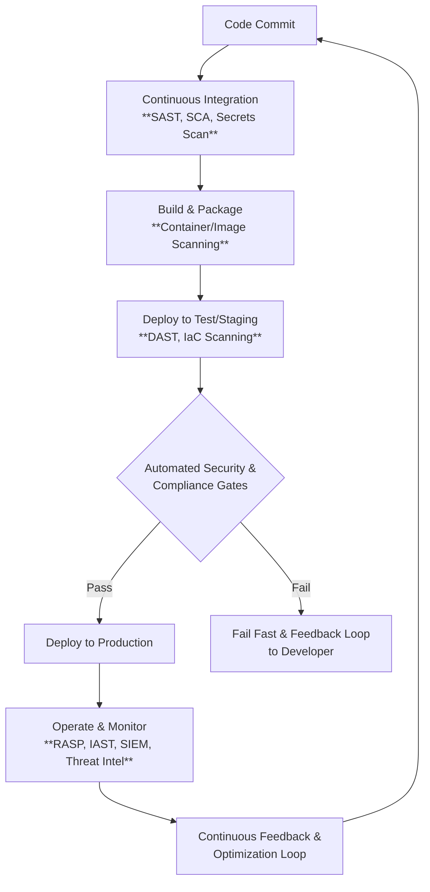

    

<h1 align="center">DEVSECOPS</h1>

    

    

  
 
## **Executive Summary**

In an era defined by accelerated digital transformation and an increasingly sophisticated threat landscape, traditional, siloed approaches to software delivery have become a critical liability. DevSecOps emerges as the essential paradigm shift, transforming security from a perimeter-based, gatekeeping function into an integrated, automated, and shared responsibility woven into the fabric of the entire Software Development Life Cycle (SDLC). This document defines DevSecOps as both a foundational culture and a set of engineering practices, detailing its components, benefits, implementation roadmap, and its profound impact on shaping resilient, future-ready IT operations. By converging Development, Security, and Operations into a cohesive "Collective Edge," organizations can achieve superior velocity, robustness, and compliance, turning security into a competitive accelerant.

 

## **1.0 Conceptual Foundation: What is DevSecOps?**

DevSecOps is the disciplined integration of security practices and principles into the DevOps pipeline. It represents a cultural and technical evolution where security is democratized—becoming a shared responsibility from initial design through to deployment and operations—rather than a separate, final phase managed by an isolated team.

### **1.1 Core Philosophy: The Dual Nature of DevSecOps**
DevSecOps is fundamentally **both a mindset and a practice**:
*   **As a Mindset (Culture):** It champions "Security as a Shared Responsibility." This "Shift-Left" culture mandates that every stakeholder—developer, QA, ops engineer—is accountable for security outcomes, fostering proactive risk identification and collaborative problem-solving.
*   **As a Practice (Implementation):** It is the tangible integration of automated security tooling and governance into Continuous Integration/Continuous Delivery (CI/CD) workflows. This includes practices like automated scanning, policy-as-code, and continuous compliance checks.

### **1.2 The "Shift-Left" and "Shift-Right" Imperative**
*   **Shift-Left:** Security controls and testing are introduced at the earliest stages of development (e.g., in IDE plugins, pre-commit hooks, and SAST during code commits). This identifies and remediates vulnerabilities when they are least costly to fix.
*   **Shift-Right:** Security monitoring, observability, and testing continue in production (e.g., via RASP, IAST, and chaos engineering). This captures vulnerabilities that only manifest under real-world conditions and ensures ongoing protection.

### **1.3 Comparative Analysis: DevOps vs. DevSecOps**

| Aspect | Traditional DevOps | DevSecOps (Enhanced DevOps) |
| :--- | :--- | :--- |
| **Primary Goal** | Speed and frequency of delivery. | Secure speed; delivering rapidly *and* securely. |
| **Security Integration** | Often a separate, final "gate" before release ("Shift-Right" only). | Integrated, automated, and continuous throughout the SDLC ("Shift-Left" + "Shift-Right"). |
| **Team Structure** | Dev + Ops collaboration. Security team operates separately. | Dev + Sec + Ops collaboration. Security is an embedded function and enabler. |
| **Security Ownership** | Primarily the Security Team's responsibility. | A shared responsibility across all roles. |
| **Remediation Cost** | High, as vulnerabilities are found late in the cycle. | Dramatically lower, due to early and continuous detection. |
| **Compliance** | Manual, audit-heavy processes. | Automated, continuous compliance (Compliance-as-Code). |

 

## **2.0 The DevSecOps Framework: Core Components & Implementation**

Successful DevSecOps rests on four interconnected pillars: Culture, Automation, Measurement, and Sharing (CAMS), applied through a structured toolchain and workflow.

### **2.1 Foundational Components**
*   **Code Analysis (SAST):** Static Application Security Testing analyzes source code for vulnerabilities without executing it, identifying issues like insecure functions, logic flaws, and coding standard violations early in the development cycle.
*   **Software Composition Analysis (SCA):** Automates visibility into open-source and third-party dependencies, identifying known vulnerabilities (CVEs) and ensuring license compliance to manage supply chain risk.
*   **Dynamic & Interactive Testing (DAST/IAST):** DAST tests running applications from the outside, mimicking an attacker. IAST instruments the application from within during testing, providing precise, real-time vulnerability data in QA or staging environments.
*   **Infrastructure as Code (IaC) Security:** Scans IaC templates (Terraform, CloudFormation) for misconfigurations before provisioning, preventing insecure infrastructure from being deployed.
*   **Secrets Management:** Systematically secures, rotates, and manages credentials, API keys, and certificates, preventing hard-coded secrets in code repositories.
*   **Policy as Code & Compliance Automation:** Codifies security and compliance policies (e.g., using Open Policy Agent - OPA) to enable automated, consistent enforcement across environments.
*   **Threat Intelligence & Modeling:** Proactively identifies potential attack vectors and prioritizes security efforts based on realistic threats to the application and business context.
*   **Continuous Monitoring & Observability:** Integrates security telemetry (logs, metrics, traces) with operational monitoring (via tools like Prometheus, Grafana, SIEM) for real-time threat detection and rapid incident response.

### **2.2 The DevSecOps Toolchain: An Integrated Ecosystem**

| Phase | Purpose | Example Tools & Technologies |
| :--- | :--- | :--- |
| **Code & Commit** | Secure code creation and initial scan. | IDE Plugins (SonarLint), Pre-commit Hooks, Git Secrets. |
| **Build & Integrate (CI)** | Analyze source and dependencies. | **SAST:** SonarQube, Checkmarx, Semgrep. **SCA:** OWASP Dependency-Check, Snyk, Black Duck. |
| **Test & Stage** | Test running applications and configs. | **DAST:** OWASP ZAP, Burp Suite. **IaC Scan:** Terrascan, Checkov. **Container Scan:** Trivy, Anchore. |
| **Deploy & Release** | Enforce policy and manage secrets. | **Policy as Code:** OPA, HashiCorp Sentinel. **Secrets Mgmt:** HashiCorp Vault, AWS Secrets Manager, SOPS. |
| **Operate & Monitor** | Protect and observe in production. | **RASP/IAST:** Contrast Security, Dynatrace. **SIEM/SOAR:** Splunk, Wazuh, Elastic SIEM. **Observability:** Prometheus, Grafana, Jaeger. |

### **2.3 Implementation Roadmap: A Phased Approach**

*   **Phase 1: Assessment & Culture Formation**
    *   Conduct a maturity assessment of current DevOps and security practices.
    *   Secure executive sponsorship and define clear "why" for the transformation.
    *   Initiate cross-functional training and establish blameless post-mortem practices to build trust.

*   **Phase 2: Foundational Automation**
    *   Integrate a single, critical security tool (e.g., SCA) into the existing CI pipeline.
    *   Establish a centralized, automated secrets management solution.
    *   Begin documenting security and compliance requirements as code.

*   **Phase 3: Pipeline Integration & Expansion**
    *   Integrate SAST and IaC scanning into the pipeline, ensuring fast feedback to developers.
    *   Implement automated security gates that can fail a build based on policy.
    *   Introduce basic container security scanning for image validation.

*   **Phase 4: Advanced Orchestration & Observability**
    *   Implement a unified dashboard for DevSecOps metrics (e.g., Mean Time to Remediate - MTTR, vulnerability trends).
    *   Integrate security event logging with the central SIEM/SOAR platform.
    *   Adopt chaos engineering and red-team exercises to validate resilience.

*   **Phase 5: Continuous Optimization & Innovation**
    *   Leverage AI/ML for anomaly detection and predictive threat analysis.
    *   Refine policies and automate compliance reporting for key frameworks (SOC2, ISO27001, etc.).
    *   Foster community contribution to internal security tooling and policies.

 

## **3.0 The DevSecOps Engineer: Role, Skills, and Impact**

The DevSecOps Engineer is the catalytic agent of this transformation, embodying the T-shaped skillset that bridges all three domains.

### **3.1 Roles and Core Responsibilities**
*   **Architect & Integrator:** Design and implement the secure CI/CD pipeline, integrating security tools without impeding developer workflow.
*   **Automation Champion:** Script and automate security controls, compliance checks, and remediation workflows.
*   **Security Advocate & Educator:** Embed with development teams, provide guidance on secure coding, and translate security requirements into developer-friendly practices.
*   **Incident Responder:** Utilize deep system knowledge to triage, respond to, and remediate security incidents rapidly, often automating the response.
*   **Risk Analyst:** Perform threat modeling and risk assessments on new features and architectures.

### **3.2 Essential Skills Matrix**

| Category | Specific Skills & Competencies |
| :--- | :--- |
| **Security Fundamentals** | Secure SDLC, threat modeling, vulnerability management, identity & access management (IAM), cryptography basics, compliance standards (NIST, PCI-DSS, GDPR). |
| **Development Proficiency** | Proficiency in one or more languages (Python, Go, Java). Understanding of code structure, APIs, and modern development frameworks. |
| **Operations & Cloud** | Deep knowledge of cloud platforms (AWS, Azure, GCP), containerization (Docker), orchestration (Kubernetes), infrastructure as code (Terraform, Ansible), and networking. |
| **Tooling & Automation** | Expertise in CI/CD tools (Jenkins, GitLab CI, GitHub Actions), security scanning tools (SAST/DAST/SCA), and scripting for automation. |
| **Soft Skills** | Collaboration, communication, adaptability, problem-solving, and a teaching mindset to bridge cultural gaps between teams. |

 

## **4.0 Impact on Future IT Operations**

DevSecOps is not a trend but the foundational model for future IT operations, driving systemic change in several key areas:

*   **From Perimeter Defense to Zero-Trust Networks:** As microservices and remote work dissolve the traditional network perimeter, DevSecOps operationalizes Zero-Trust principles. Security is enforced at the identity, workload, and data layer, with continuous verification mandated by pipeline policies and runtime controls.
*   **The Rise of AI/ML in Security (AI-SecOps):** The volume of telemetry and threats will necessitate AI-driven analysis. DevSecOps pipelines will incorporate AI for predictive vulnerability detection, automated code remediation suggestions, and intelligent anomaly detection in logs and metrics, dramatically reducing response times.
*   **Quantum-Resilient Cryptography by Design:** Future-proofing against quantum computing threats will become a standard pipeline requirement. DevSecOps practices will mandate the audit and phased integration of post-quantum cryptographic algorithms into application and communication security, managed as a dependency and configuration item.
*   **Sustainability and Security Convergence:** Efficient, secure code is inherently more sustainable (requiring less compute resource). Future DevSecOps metrics will expand to include carbon footprint analysis of deployments, aligning security, efficiency, and environmental goals.
*   **Democratization of Compliance:** "Compliance-as-Code" will mature, allowing organizations to express regulatory frameworks as executable policies. This will enable continuous, demonstrable compliance, turning audit preparations from a quarterly panic into a real-time dashboard, significantly reducing cost and risk.

 

## **5.0 Challenges and Strategic Considerations**

*   **Cultural Resistance:** Overcoming siloed mindsets and "throw-it-over-the-wall" histories is the most significant hurdle. This requires persistent leadership, measurable incentives for secure behavior, and celebrating "security wins" as team achievements.
*   **Skills Gap & Training:** The demand for DevSecOps talent outpaces supply. Organizations must invest in upskilling existing staff through hands-on training programs, internal mentorship, and incentivized certification paths.
*   **Tool Sprawl & Integration Fatigue:** The vast landscape of point solutions can lead to complex, fragile toolchains. Strategic focus should be on integrated platforms, open standards (like OpenTelemetry), and building internal expertise in a curated set of core tools.
*   **Measuring Success & ROI:** Moving beyond vanity metrics to business-aligned KPIs is critical. Key metrics include **Mean Time to Remediate (MTTR)** vulnerabilities, **Deployment Frequency** (maintained or improved post-security integration), **Change Failure Rate**, and the percentage of **Automated Compliance Checks**.

## **6.0 Conclusion: Securing the Future, One Pipeline at a Time**

DevSecOps represents the essential synthesis of agility, security, and resilience required for modern digital enterprises. It moves security from a cost center and bottleneck to a core business enabler and competitive differentiator. By fostering a culture of shared ownership, leveraging comprehensive automation, and embedding security into the DNA of the development lifecycle, organizations can build the "Collective Edge" necessary to innovate fearlessly in the face of evolving threats. The future of IT operations belongs to those who can deliver software that is not only functional and fast but also fundamentally secure and trustworthy. The journey to mature DevSecOps is iterative and demanding, but the alternative—increasing vulnerability, regulatory failure, and eroded customer trust—is no longer a viable option.

**Adopt. Adapt. Secure.**

     
