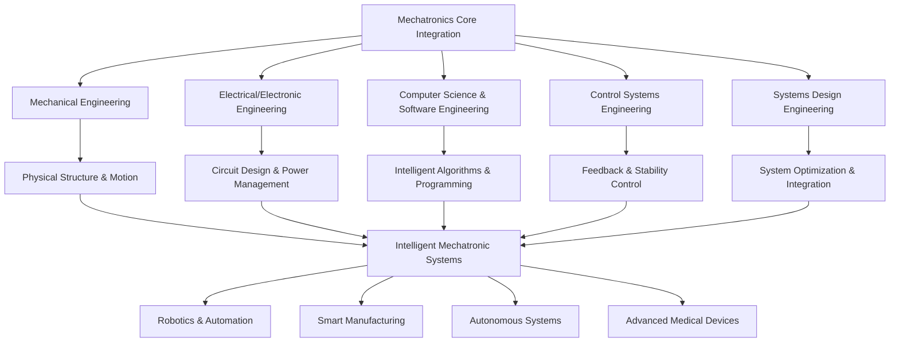
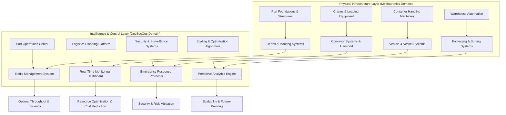
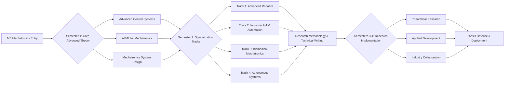

    

<h1 align="center">MECHATRONICS</h1>

    

    

  

## **Executive Summary**

Mechatronics represents the fundamental convergence of mechanical, electrical, computer, and control engineering disciplines, creating intelligent systems that form the physical execution layer of modern technological ecosystems. This document presents a comprehensive framework positioning mechatronics as the critical bridge between physical automation and digital intelligence systems. Through an innovative harbor analogy, we map the complete modern IT and industrial automation stack onto a unified maritime logistics framework, providing intuitive mental models for technical teams while maintaining engineering precision for implementation guidance.

## **1.0 The Convergence of Engineering Disciplines**

### **1.1 Definition and Core Philosophy**

Mechatronics is an interdisciplinary engineering domain that synergistically integrates mechanical systems, electronics, control theory, and computer science to design, create, and operate intelligent systems. Unlike traditional engineering silos, mechatronics adopts a holistic systems approach where the complete system behavior emerges from the integrated interaction of all components rather than from individual subsystem optimization.

### **1.2 Historical Evolution and Technological Progression**

The evolution of mechatronics follows a clear trajectory from simple electromechanical systems to today's intelligent, networked cyber-physical systems:

* **First Generation (1970s-1980s)**: Basic integration of mechanical components with simple electronic controls, characterized by stand-alone automated machines with limited programmability and minimal sensory feedback.
* **Second Generation (1990s-2000s)**: Introduction of microprocessors and digital controls enabling programmable automation, with systems featuring embedded intelligence and basic sensory feedback loops.
* **Third Generation (2000s-2010s)**: Integration of networking capabilities and advanced sensors, enabling distributed control systems, remote monitoring, and basic predictive maintenance functionalities.
* **Fourth Generation (2010s-Present)**: Convergence with artificial intelligence, machine learning, and cloud computing, creating adaptive systems capable of self-optimization, autonomous decision-making, and seamless integration with digital twins and Industry 4.0 frameworks.

### **1.3 The Interdisciplinary Knowledge Matrix**

The mechatronics engineering curriculum is structured around a core matrix of interdependent knowledge domains:

| **Domain Category** | **Core Subjects** | **Practical Applications** | **Future Evolution** |
|---------------------|-------------------|----------------------------|----------------------|
| **Mechanical Foundation** | Statics & Dynamics, Mechanics of Materials, Thermodynamics, Fluid Mechanics | Structural design, motion systems, thermal management, hydraulic/pneumatic systems | Smart materials, additive manufacturing, micro-electromechanical systems |
| **Electrical & Electronic Systems** | Circuit Theory, Digital Electronics, Power Electronics, Microelectronics | Power distribution, signal processing, embedded hardware, motor drives | Flexible electronics, wide-bandgap semiconductors, energy harvesting systems |
| **Control & Automation** | Control Systems Engineering, Robotics, Industrial Automation, Signal Processing | PID control, robotic manipulation, PLC programming, sensor data processing | Adaptive control, model predictive control, swarm intelligence, brain-computer interfaces |
| **Computational Intelligence** | Embedded Systems, Artificial Intelligence, Computer Vision, Real-Time Systems | Microcontroller programming, machine learning algorithms, image processing, RTOS | Edge AI, neuromorphic computing, quantum control systems, explainable AI |
| **Systems Integration** | Mechatronic System Design, CAD/CAM, Systems Engineering, Project Management | System prototyping, 3D modeling, integration testing, lifecycle management | Digital twin integration, model-based systems engineering, autonomous system validation |

## **2.0 The Harbor Analogy: A Unified Framework for Modern Technological Ecosystems**

### **2.1 Conceptual Framework**

The modern technological landscape can be comprehensively mapped onto a maritime logistics framework, where mechatronics constitutes the physical infrastructure and operational machinery, while DevSecOps provides the intelligent coordination, security, and scalability mechanisms.

### **2.2 Complete System Mapping**

### **2.3 Detailed Component Analysis**

#### **2.3.1 Physical Infrastructure Elements (Mechatronics)**

* **Port Foundations & Berths**: Represent the core mechanical and structural engineering components—the physical machines, robots, conveyors, and production lines that form the tangible assets of industrial operations. These systems are designed for durability, precision, and reliability under continuous operational stress, analogous to docks built to withstand tidal forces and heavy vessel impacts while providing stable operational platforms.
* **Cranes & Loading Equipment**: Correspond to robotic manipulators, automated guided vehicles (AGVs), and material handling systems that transfer, position, and assemble components within the manufacturing ecosystem. Like port cranes that must precisely position multi-ton containers, industrial robots execute millimeter-accurate movements while managing variable payloads and environmental conditions.
* **Container Handling Systems**: Map onto modular production units, palletizing systems, and standardized interfaces that enable efficient material flow. Just as shipping containers revolutionized global logistics through standardization, mechatronic systems implement modular design principles allowing rapid reconfiguration and scalability of production processes.
* **Vessel & Vehicle Systems**: Represent mobile robotic platforms, autonomous transport vehicles, and drone systems that provide dynamic material movement capabilities. These systems incorporate advanced navigation, obstacle avoidance, and fleet coordination algorithms while maintaining robust physical construction for operational reliability.

#### **2.3.2 Intelligence & Control Systems (DevSecOps)**

* **Port Operations Center**: Functions as the central nervous system—the cloud platforms, data analytics engines, and control software that orchestrate operations across the entire ecosystem. This layer processes sensory data, executes control algorithms, and implements business logic while maintaining system-wide situational awareness.
* **Traffic Management System**: Implements the coordination algorithms, scheduling optimizers, and real-time routing logic that prevent collisions, eliminate bottlenecks, and maximize throughput. Advanced implementations utilize machine learning to predict congestion patterns and dynamically adjust operational parameters.
* **Logistics Planning Platform**: Provides the development, testing, and deployment frameworks that enable rapid adaptation to changing requirements. Continuous integration pipelines automate validation of control logic, while containerization ensures consistent execution across diverse hardware platforms.
* **Security & Surveillance Systems**: Implement cybersecurity protocols, access controls, and intrusion detection mechanisms that protect both physical assets and data integrity. Distributed sensor networks monitor for anomalous behavior while automated response systems contain threats without disrupting core operations.

### **2.4 Operational Synergy and Value Proposition**

The true power of the integrated harbor ecosystem emerges from the seamless interaction between physical infrastructure and intelligent control systems:

* **Dynamic Resource Allocation**: Just as port operators reroute cranes and vehicles based on real-time vessel arrivals and cargo priorities, mechatronic systems dynamically reconfigure production lines in response to changing orders, equipment availability, and quality metrics.
* **Predictive Maintenance Integration**: Harbor maintenance schedules are optimized using vessel tracking data, weather forecasts, and equipment health monitoring—paralleling how industrial IoT sensors feed data to predictive algorithms that schedule maintenance before failures occur.
* **Scalability Through Standardization**: Container shipping achieved global dominance through standardized interfaces that work across diverse vessels, cranes, and transport modes. Similarly, mechatronic systems implement standardized communication protocols (OPC UA, MQTT) and modular mechanical interfaces that enable seamless integration and scaling.
* **Resilience Through Redundancy**: Critical harbor operations maintain multiple equipment options and alternate routing paths. Mechatronic systems implement hardware redundancy, graceful degradation capabilities, and fail-safe mechanisms that ensure continued operation despite component failures.

## **3.0 Academic Foundations: BE and ME Mechatronics Curriculum Analysis**

### **3.1 Undergraduate (BE) Program Structure**

The Bachelor of Engineering in Mechatronics follows a progressive curriculum designed to build layered competencies:

| **Academic Year** | **Core Competency Focus** | **Key Subjects** | **Practical Skill Development** |
|-------------------|---------------------------|------------------|--------------------------------|
| **First Year** | Foundational Engineering Principles | Mathematics I & II, Physics, Chemistry, Engineering Graphics, Basic Programming | Engineering drawing interpretation, basic circuit construction, introductory programming logic |
| **Second Year** | Core Discipline Fundamentals | Mechanics of Materials, Digital Electronics, Fluid Mechanics, Control Systems, Material Science | CAD modeling, microcontroller programming, sensor interfacing, basic control system implementation |
| **Third Year** | Systems Integration & Specialization | Robotics Engineering, Microprocessors, Mechanical Design, Signal Processing, Industrial Automation | Robot programming, PLC ladder logic development, system simulation, embedded systems design |
| **Fourth Year** | Advanced Applications & Capstone Implementation | AI/ML Applications, Mechatronic System Design, Power Electronics, Renewable Energy Systems, Major Project | Complete system design-build-test cycles, industry-standard tool mastery, professional documentation |

### **3.2 Postgraduate (ME) Program Structure**

The Master of Engineering curriculum focuses on advanced integration and research-driven innovation:

### **3.3 Critical Knowledge Integration Points**

The curriculum structure emphasizes specific integration nodes where interdisciplinary knowledge converges:

* **Control System Implementation**: Students learn to translate mathematical control theory into embedded C code executing on microcontrollers while accounting for mechanical response characteristics and electronic signal conditioning requirements.
* **Sensor-Actuator Coordination**: Courses bridge the gap between sensor physics, analog signal conditioning circuits, digital filtering algorithms, and mechanical actuation responses to create responsive closed-loop systems.
* **System Modeling and Simulation**: Advanced courses teach multi-domain modeling techniques using tools like MATLAB/Simulink that simultaneously simulate mechanical dynamics, electronic circuits, control algorithms, and thermal effects.
* **Cyber-Physical System Security**: Emerging curriculum elements address the intersection of real-time control requirements, network communication protocols, and cybersecurity principles to create resilient industrial systems.

## **4.0 Real-World Impact and Application Domains**

### **4.1 Industrial Transformation**

Mechatronics drives fundamental transformation across industrial sectors through several key mechanisms:

* **Manufacturing Evolution**: Traditional assembly lines evolve into flexible manufacturing cells where collaborative robots, vision systems, and AGVs reconfigure dynamically based on real-time production requirements. This transformation reduces changeover times from hours to minutes while improving quality consistency through automated inspection systems.
* **Predictive Maintenance Revolution**: Integrated sensor networks continuously monitor equipment health indicators including vibration spectra, thermal profiles, and acoustic emissions. Machine learning algorithms process this data to predict failures days or weeks in advance, reducing unplanned downtime by up to 50% while optimizing maintenance resource allocation.
* **Energy Efficiency Optimization**: Mechatronic systems implement sophisticated energy management strategies that adjust motor speeds, regulate hydraulic pressures, and schedule equipment operation based on real-time energy pricing and production requirements. These optimizations typically achieve 15-30% energy reduction without compromising throughput.
* **Quality Assurance Automation**: Advanced vision systems combined with robotic manipulation enable 100% inspection rates at production speeds previously requiring statistical sampling. Deep learning algorithms detect defects invisible to human inspectors while adaptive control systems automatically adjust process parameters to correct emerging quality issues.

### **4.2 Healthcare Advancements**

Medical technology represents one of the most impactful application domains for advanced mechatronics:

* **Surgical Robotics**: Systems like the da Vinci Surgical System exemplify the convergence of precision mechanics, haptic feedback controls, 3D visualization, and surgeon interface design. These systems translate surgeon hand movements into scaled, filtered motions while eliminating physiological tremor and providing enhanced visualization.
* **Prosthetic and Rehabilitation Devices**: Modern prosthetic limbs incorporate multiple degrees of freedom controlled through myoelectric signals, inertial measurement units, and sometimes direct neural interfaces. These systems require seamless integration of mechanical joints, actuator systems, power management electronics, and adaptive control algorithms.
* **Diagnostic Automation**: Laboratory automation systems precisely handle biological samples, execute complex assay protocols, and analyze results with minimal human intervention. These systems dramatically increase testing throughput while reducing human error and exposure to hazardous materials.
* **Drug Delivery Systems**: Smart infusion pumps and implantable drug delivery devices precisely regulate medication administration based on continuous physiological monitoring. These closed-loop systems represent the ultimate integration of sensing, control, and actuation for life-critical applications.

### **4.3 Sustainable Infrastructure Development**

Mechatronic systems play crucial roles in developing sustainable urban and industrial infrastructure:

* **Smart Grid Management**: Advanced monitoring and control systems balance energy generation, storage, and consumption across distributed renewable resources. These systems require robust communication networks, predictive algorithms, and power electronics capable of managing highly variable energy flows.
* **Intelligent Transportation Systems**: Autonomous vehicles represent the most visible application, but equally important are traffic management systems that optimize signal timing, parking guidance systems that reduce urban congestion, and freight logistics platforms that minimize empty miles.
* **Water Resource Management**: Automated irrigation systems adjust watering schedules based on soil moisture, weather forecasts, and plant requirements. Water treatment plants utilize advanced sensor networks and control systems to optimize chemical dosing while monitoring effluent quality.
* **Building Automation**: Modern building management systems integrate HVAC control, lighting automation, occupancy monitoring, and security systems to reduce energy consumption while maintaining occupant comfort. These systems typically achieve 20-40% energy savings compared to conventional building operations.

## **5.0 Future Trajectory and Emerging Frontiers**

### **5.1 Technological Convergence Trends**

The future evolution of mechatronics will be driven by convergence with several adjacent technology domains:

| **Convergence Domain** | **Integration Mechanism** | **Expected Impact** | **Time Horizon** |
|------------------------|--------------------------|---------------------|------------------|
| **Artificial Intelligence** | Embedded machine learning at the edge for adaptive control and anomaly detection | Systems that self-optimize based on operational experience and predict failures before they occur | 2-5 years for widespread adoption |
| **Advanced Materials** | Integration of shape-memory alloys, piezoelectric materials, and metamaterials into actuation and sensing systems | Lighter, more efficient systems with novel capabilities like shape adaptation and energy harvesting | 5-10 years for commercial applications |
| **Quantum Sensing** | Utilization of quantum effects for ultra-precise measurement of magnetic fields, acceleration, and rotation | Navigation systems that don't require GPS, medical imaging with unprecedented resolution, and geological exploration breakthroughs | 10-15 years for practical implementations |
| **Neuromorphic Computing** | Implementation of control algorithms on hardware that mimics biological neural networks | Drastically reduced power consumption for complex pattern recognition and control tasks, enabling more autonomous edge devices | 5-8 years for specialized applications |

### **5.2 Educational Evolution Requirements**

To prepare engineers for these emerging challenges, mechatronics education must evolve in several key directions:

* **Increased Computational Focus**: Curriculum must expand beyond traditional programming to include data science, machine learning implementation, and cloud integration skills while maintaining strong foundations in physical system design.
* **Cybersecurity Integration**: As mechatronic systems become increasingly connected, engineers must understand not just functional safety but also cybersecurity principles, secure communication protocols, and intrusion detection mechanisms.
* **Lifecycle Thinking Expansion**: Education must extend beyond design and implementation to include circular economy principles, remanufacturing considerations, and end-of-life recovery strategies for sustainable system development.
* **Human-System Integration**: As collaborative robots and autonomous systems become more prevalent, engineers need skills in human factors engineering, ethical AI implementation, and human-robot interaction design.

### **5.3 Organizational Implementation Framework**

Successfully implementing advanced mechatronic systems requires coordinated organizational adaptation:

* **Cross-Functional Team Structures**: Organizations must establish integrated teams combining mechanical, electrical, software, and control engineers working collaboratively from initial concept through deployment and maintenance.
* **Digital Thread Implementation**: Organizations should implement comprehensive digital thread strategies that maintain consistency from initial requirements through design, simulation, manufacturing, and operational data analytics.
* **Continuous Skills Development**: Given the rapid evolution of technologies, organizations must establish continuous learning pathways that keep engineering teams current with emerging tools, methodologies, and best practices.
* **Ecosystem Partnership Development**: No single organization can maintain expertise across all relevant domains, requiring strategic partnerships with academic institutions, technology providers, and specialized engineering firms.

## **6.0 Conclusion and Strategic Recommendations**

### **6.1 Synthesis of Key Insights**

Mechatronics has evolved from a niche integration specialty to the foundational discipline enabling intelligent physical systems across all industrial sectors. The harbor analogy provides a powerful framework for understanding how physical automation systems (the port infrastructure) and intelligent coordination systems (the operations center) must work in concert to achieve optimal performance. This integrated perspective reveals several critical insights:

* **Symbiotic Relationship**: Mechatronics and DevSecOps are not competing paradigms but complementary domains—mechatronics creates machines that move with precision and reliability, while DevSecOps creates systems that think, connect, scale, and remain secure.
* **Abstraction Hierarchy Necessity**: Successful implementations require clear abstraction boundaries between physical execution layers and intelligent coordination layers, with well-defined interfaces enabling innovation within each domain without compromising system integrity.
* **Evolutionary Trajectory**: The convergence trajectory points toward increasingly autonomous systems where mechatronic platforms execute complex tasks with minimal explicit programming, guided instead by high-level objectives and continuous learning from operational data.

### **6.2 Strategic Implementation Recommendations**

Based on this analysis, organizations should consider the following strategic initiatives:

* **Adopt the Harbor Analogy as a Communication Framework**: Use this mental model to facilitate cross-disciplinary understanding between mechanical, electrical, software, and operations teams, particularly when planning integrated system implementations.
* **Implement Gradual Integration Pathways**: Begin with pilot projects that demonstrate the value of integrated mechatronic systems before scaling to enterprise-wide implementations, focusing initially on high-impact, well-defined applications.
* **Develop Hybrid Talent Pipelines**: Invest in educational programs and internal training that develop engineers with both deep domain expertise in traditional engineering disciplines and broad integration skills across the mechatronic spectrum.
* **Establish Digital Foundation Infrastructure**: Prioritize implementation of the digital thread, standardized communication protocols, and data architecture that will enable increasingly sophisticated integration between physical systems and intelligent control layers.
* **Embrace Ecosystem Collaboration**: Actively participate in standards development, academic research partnerships, and industry consortia to stay abreast of emerging technologies and best practices in mechatronic system implementation.

The future of industrial innovation will be built on the foundation of advanced mechatronic systems—intelligent, connected, and adaptable platforms that transform raw materials into valuable products, monitor and maintain critical infrastructure, and enhance human capabilities across every sector of the economy. Organizations that master the integration of physical automation with intelligent coordination systems will achieve unprecedented levels of efficiency, quality, and adaptability in an increasingly competitive and rapidly evolving global landscape.

 

## **Appendix A: Reference Implementation Patterns**

### **A.1 Modular Mechatronic System Architecture**

Successful mechatronic implementations typically follow modular architectural patterns that separate concerns while enabling integration:

* **Hardware Abstraction Layer**: Standardized interfaces between mechanical components, sensors, actuators, and control electronics that enable component substitution without system redesign.
* **Middleware Communication Layer**: Industry-standard protocols (OPC UA, MQTT, DDS) that facilitate data exchange between subsystems while accommodating varying performance requirements and network conditions.
* **Application Logic Layer**: Platform-independent control algorithms and business logic that can be validated through simulation before deployment to physical hardware.
* **Orchestration and Management Layer**: Cloud-based or edge-based systems that coordinate multiple mechatronic units, implement system-wide optimizations, and provide operational visibility.

### **A.2 Validation and Testing Methodology**

Given the safety-critical nature of many mechatronic applications, comprehensive validation strategies are essential:

* **Model-in-the-Loop Simulation**: Initial validation of control algorithms against high-fidelity plant models before any physical implementation.
* **Hardware-in-the-Loop Testing**: Validation of electronic control units with simulated mechanical responses to verify signal integrity and timing performance.
* **Software-in-the-Loop Testing**: Validation of application software against simulated hardware interfaces to verify functional correctness.
* **Physical System Integration Testing**: Gradual integration of validated components into complete system configurations with increasing operational scope and complexity.

    
